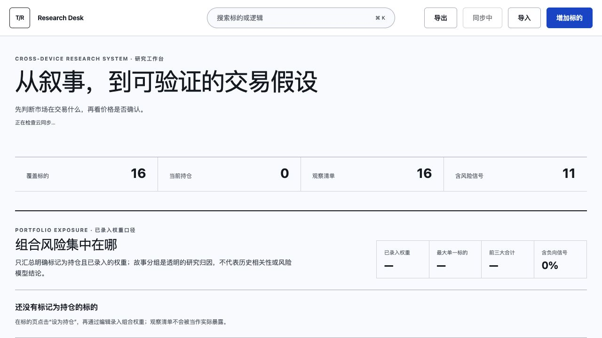
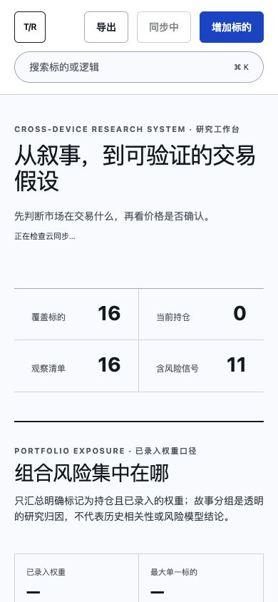
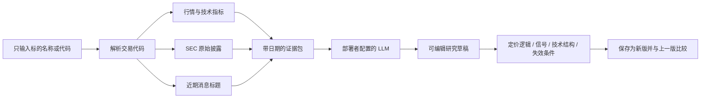
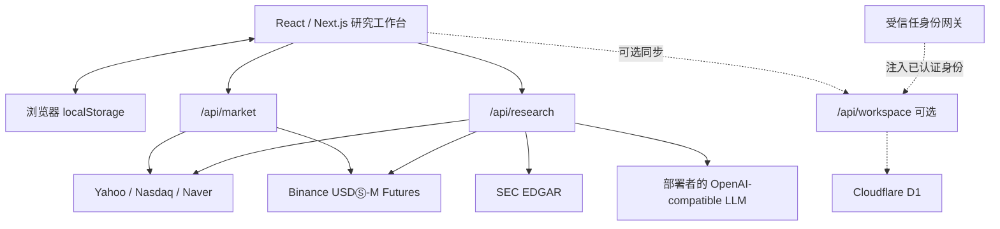

# Trader Research Desk

> 把推特叙事拆成可验证的定价逻辑、证据、价格确认与行动复盘。

[](LICENSE)
[](package.json)
[](#验证与测试)

**[在线演示](https://trader-research-desk.meishanlu33.chatgpt.site)** · 演示站由原作者维护；Fork 后的 LLM 费用与密钥由部署者自己承担。

Trader Research Desk 是一个面向美股、ETF、商品和加密资产的本地优先研究工作台。
它不替你喊单，而是强迫每个故事回答四个问题：市场在重新定价什么、什么证据能
验证它、价格有没有确认、判断错了在哪里退出。

LLM 只负责生成**可编辑研究草稿**。行情、SEC 文件和消息标题先由服务端获取并
组成证据包，再交给部署者自己配置的模型。仓库不包含任何 API Key、私人持仓或
云端工作区数据。

## 界面预览



<p align="center">
  
</p>

## 它解决什么问题

| 常见问题 | 工作台如何处理 |
| --- | --- |
| 推特上的故事很多，不知道市场真正交易什么 | 把叙事改写成估值变量、当前假设、催化和失效条件 |
| 财报很好但股价下跌，不知道属于哪种下杀 | 用第一/二/三类框架区分趋势确认、估值与仓位出清、盈利与估值双杀 |
| 新闻很多，不知道今天先看什么 | 按持仓、研究过期、负向信号和证伪状态生成研究队列 |
| 多个持仓看似不同，实际都押注同一个故事 | 按真实持仓权重汇总单一标的和风险故事暴露 |
| 每次改变看法后忘记旧逻辑 | 只保留上一版和最新版，逐条显示改变原因、已验证、已证伪与待验证 |
| 交易计划停留在脑中 | 保存等待、建仓、加仓、减仓、退出、对冲及复盘日期 |

## 研究逻辑

### 1. 先分类，再决定动作

- **第一类：基本面向上，价格确认。** 订单、盈利预期和价格趋势同时改善。
- **第二类：基本面尚强，估值与仓位出清。** 好消息无法继续抬高价格，市场在
  消化拥挤、估值或资本回报率担忧。
- **第三类：基本面与价格共同下修。** 订单、价格、毛利率或盈利预期下降，叠加
  估值压缩。
- **待分类：** 证据不足时不强行给结论。

分类不是永久标签。点击“AI 更新逻辑”后，系统会读取近期证据，和上一版逐项
比较，而不是直接覆盖历史判断。

### 2. 证据先于模型



模型不能把缺失资料写成事实。SEC、行情或消息源不可用时，界面会保留数据缺口；
免费行情和标题线索也不会被描述成交易所级实时数据或已核验结论。

### 3. 技术指标是透明复现，不是黑箱信号

K 线支持 `4H`、`6H`、日线和周线，并可单独开关指标。当前公开框架包括：

- EMA20 / EMA50 趋势；
- `(EMA20 - EMA50) / ATR14` 动量，阈值为 `±0.6`；
- ATR/价格相对 50 期中位数的宽幅、常态、窄幅状态；
- 近 10 期相对前 10 期的 `HH + HL`、`LH + LL` 结构；
- 20 期价格通道、通道中位与滚动 VWAP；
- QQQ 按日期保存文字预期、确认价、失效价和未来路径图层。

这是根据公开内容整理的可审计近似，不是任何作者未公开的付费公式。

### 4. 组合风险只计算有依据的权重

只有状态为“持仓”的标的才计入组合。建议填写明确的组合权重；旧版形如 `2%`
的仓位文本仍可兼容。未填写权重的持仓会显示为缺口，不会被当成零仓位，也不会
按数量平均分配。

“同一故事”是可编辑的研究归因，用于发现多个标的共同押注 AI 资本开支、久期、
加密流动性、贵金属或能源等变量。它不等于统计相关性、VaR、波动率或实时盈亏。
单一标的 20% 和同一故事 40% 只是默认提醒线，不是自动止损。

## 功能地图

- 币安美股交易发现器：从币安官方合约名录筛选全部处于 `TRADING` 状态的 `TRADIFI_PERPETUAL` / `EQUITY` 产品，与完整美国挂牌名录核对，筛选对应正股连续两个已收盘周的阳线；支持暂停、续扫、缺失行情重试、查看K线及加入研究，扫描不依赖自选清单。
- 自选与持仓：搜索、筛选、导入、导出和本地持久化。
- AI 新增标的：输入名称后生成代码、定价逻辑、假设、信号、技术结构和来源。
- AI 更新逻辑：读取近期证据，与上一版做差异比较。
- 每日研究队列：决定今天先更新哪个标的，而不是给买卖方向。
- 30 日事件雷达：只对明确日期倒计时，不制造伪精确事件。
- K 线与指标：真实 OHLC、4H/6H/日/周周期和指标开关。
- QQQ 推演：按日期归档文字预期及预测图层。
- 情景定价：记录牛/基准/熊情景、概率和风险预算，不连接券商。
- 决策日志：记录动作与复盘结果，区分信息错误和执行错误。
- 组合暴露：按实际权重汇总标的、故事、研究类别与负向信号。

## 数据与系统架构



| 数据 | 来源 | 边界 |
| --- | --- | --- |
| 全市场上市名录 | Nasdaq Trader nasdaqlisted / otherlisted | 合并所有非测试挂牌代码，不用预置热门标的代替全市场 |
| 币安可交易美股初筛 | Binance Futures exchangeInfo | 按交易状态、合约类型和底层资产类别筛选；不以代码相似判断，不核验个人账户权限 |
| 两周阳线发现 | Nasdaq / Yahoo 正股日线复核 | 周K线为正股交易时段口径；币安合约24/7周线可能不同；缺失行情与映射单列 |
| 美股/ETF/商品 K 线 | Yahoo Finance，Nasdaq 作为部分日线回退 | 免费源可能延迟、限流或改变接口 |
| 韩股 K 线 | Naver Finance | 不是交易所下单行情 |
| BTC/ETH 永续 | Binance USDⓈ-M Futures | 读取公开价格、资金费率、持仓量；不提交订单 |
| 公司披露 | SEC EDGAR | 仅适用于能够解析 CIK 的公司 |
| 近期消息 | Yahoo 搜索结果标题 | 标题只是线索，不能替代原文与公司披露 |
| 研究草稿 | 部署者配置的 LLM | 可能出错，保存前必须人工复核 |

## 快速开始

要求 Node.js `>=22.13.0`。

```bash
git clone https://github.com/niguangerlai/trader-research-desk.git
cd trader-research-desk
npm ci
cp .dev.vars.example .dev.vars
```

编辑 `.dev.vars`，换成你自己的密钥：

```dotenv
LLM_API_KEY=replace-with-your-own-key
LLM_BASE_URL=https://api.deepseek.com
LLM_MODEL=deepseek-v4-pro
WORKSPACE_SYNC_MODE=disabled
SEC_USER_AGENT=Trader Research Desk your-email@example.com
```

启动：

```bash
npm run dev
```

打开 [http://localhost:3000](http://localhost:3000)。没有配置 LLM Key 时，默认
研究数据、手动编辑、组合面板、图表和导入导出仍然可用；AI 新增和 AI 更新会
明确提示“分析引擎尚未配置”。

交易发现器无需 LLM Key。点击“扫描币安美股”后，先筛币安正在交易的美股/ETF类永续合约，再逐批复核对应正股；收盘周按美国东部时间确定，周阳线要求周末收盘严格高于周初开盘，当前未收盘周不参与。可暂停后继续。Sites 部署把扫描结果缓存到 D1；自部署未配置 D1 时仅保留服务进程内缓存，刷新服务会丢失扫描缓存。

如果币安拒绝托管服务器的连接，界面会改为浏览器直接读取官方公开 `exchangeInfo` 和报价接口，再由服务端核对完整美国挂牌名录和历史K线。浏览器直连名录只影响当前扫描，服务端共享缓存只写入自行计算的正股周线结果。浏览器和服务器均无法访问币安时，界面明确报错。

## LLM 配置

### DeepSeek V4 Pro

本项目默认按 DeepSeek 的 OpenAI Chat Completions 接口调用：

```dotenv
LLM_API_KEY=你的 DeepSeek API Key
LLM_BASE_URL=https://api.deepseek.com
LLM_MODEL=deepseek-v4-pro
```

请用 `/models` 或供应商控制台确认你的账户实际可用模型；若账号尚未列出
`deepseek-v4-pro`，请把 `LLM_MODEL` 改为实际返回的模型 ID。模型 Key 只在服务端
读取，不会被打进浏览器 JavaScript。不要把 `.dev.vars`、`.env.local` 或 Key
提交到 Git。

### 其他 OpenAI-compatible 服务

也可以换成实现 `/chat/completions`、`response_format: json_object` 且返回
`choices[0].message.content` 的服务：

```dotenv
LLM_API_KEY=your-provider-key
LLM_BASE_URL=https://your-provider.example/v1
LLM_MODEL=your-json-capable-model
```

仅当地址或模型名识别为 DeepSeek 时，系统才发送 `thinking` 和
`reasoning_effort` 扩展字段。为兼容旧部署，`DEEPSEEK_API_KEY`、
`DEEPSEEK_BASE_URL`、`DEEPSEEK_MODEL` 仍可使用，但新部署建议统一用 `LLM_*`。

> 成本与滥用边界：公开部署 `/api/research` 前，应在 Cloudflare 或自己的网关
> 增加身份验证、速率限制和额度报警。仓库不会替部署者提供或代付模型额度。

## 部署到 Cloudflare Workers

当前运行时使用 vinext 和 Cloudflare Vite 插件。公开模板默认采用本机保存模式，
不需要 D1。

```bash
npm ci
cp wrangler.example.jsonc wrangler.jsonc
npx wrangler login
npx wrangler secret put LLM_API_KEY
npm run deploy
```

在 `wrangler.jsonc` 中修改 `LLM_BASE_URL`、`LLM_MODEL` 和 `SEC_USER_AGENT`。
`wrangler.jsonc` 被忽略，避免误提交部署者的账户、数据库或路由配置。

Cloudflare Vite 开发环境使用 `.dev.vars` 保存本地秘密；生产环境应使用 Wrangler
secret 或 Cloudflare Dashboard。不要把 API Key 写进 `vars`。

### 可选：跨设备同步

默认 `WORKSPACE_SYNC_MODE=disabled`，所有研究数据保存在当前浏览器，可通过 JSON
导入导出迁移。仓库保留 D1 schema、迁移和冲突合并逻辑，但 `/api/workspace`
只信任由上游身份网关注入的认证头。

如果你的部署平台没有受信任身份网关，不要只把同步开关改成 enabled；应先替换
`app/chatgpt-auth.ts`，接入你自己的会话认证，并确保用户无法伪造身份头。完成认证后：

1. 创建 D1 数据库并绑定为 `DB`；
2. 执行 `npx wrangler d1 execute <database-name> --remote --file=drizzle/0000_dashing_gambit.sql`；
3. 后续 schema 变更继续由 Drizzle 生成 SQL，并在部署前应用；
4. 将 `WORKSPACE_SYNC_MODE` 改成 `enabled`；
5. 验证不同用户只能访问自己的工作区。

## 使用说明

1. 打开首页，先浏览内置研究框架；这些是带日期的演示数据，不是当前推荐。
2. 点击“增加标的”，输入公司名或代码，让 AI 生成第一版草稿。
3. 核对来源、数据日期、定价逻辑、验证信号和失效条件，再保存。
4. 需要刷新时点击“AI 更新逻辑”，在版本对比页检查是什么证据改变了判断。
5. 实际持有时点击“设为持仓”，编辑组合权重和风险故事分组。
6. 在 K 线页切换周期与指标；QQQ 可按日期保存预期路径。
7. 在情景定价页写下入场、失效、目标、概率和风险预算。
8. 保存决策并设置复盘日期，之后记录“正确、部分正确、错误或未触发”。
9. 定期导出 JSON 备份；清除浏览器数据会删除未同步的本地研究。

## 验证与测试

```bash
npm run lint
npm test
```

`npm test` 会先执行生产构建，然后检查服务端渲染、公开能力是否仍在源码中，以及
K 线聚合、事件雷达、情景计算、组合风险、SEC 证据、研究队列和跨设备冲突合并等
逻辑。

## 代码导航

| 路径 | 作用 |
| --- | --- |
| `app/page.tsx` | 主工作台、本地存储、同步状态与研究交互 |
| `app/api/research/route.ts` | 证据收集、提示词、LLM 调用与输出清洗 |
| `app/api/market/route.ts` | Yahoo、Nasdaq、Naver、Binance 行情适配 |
| `app/sec-evidence.ts` | SEC ticker/CIK、filing 和附件抽取 |
| `app/components/MarketChart.tsx` | Lightweight Charts K 线与图层 |
| `app/components/ChartResearchView.tsx` | 周期、指标开关和 QQQ 推演归档 |
| `app/portfolio-risk.ts` | 持仓权重、故事暴露与数据完整度 |
| `app/decision-log.ts` | 决策日志与复盘队列 |
| `app/workspace-sync.ts` | 工作区规范化、跨设备合并和删除墓碑 |
| `drizzle/` | 可选 D1 数据库迁移 |
| `tests/` | 逻辑与渲染合同测试 |

## 隐私、安全与免责声明

- API Key 只应保存在服务端 secret manager；前端没有填写 Key 的入口。
- 默认研究数据是演示内容，日期可能过期，首次使用应主动刷新。
- 自选、持仓、成本和交易计划属于敏感信息；本机模式下只存在当前浏览器。
- 本项目不连接券商、不发送订单、不保证数据实时性，也不构成投资建议。
- 公开实例应为 `/api/research` 配置认证、速率限制和费用报警。
- 安全问题请参阅 [SECURITY.md](SECURITY.md)。

## 开源许可

[MIT License](LICENSE)。欢迎 Fork、部署、提交 Issue 和 Pull Request。如果这个项目
帮助你把“故事”变成了可证伪的研究过程，欢迎点一个 Star。
